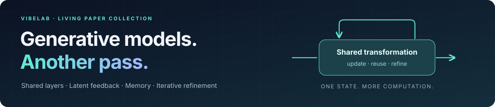

  

<h1 align="center">Awesome Loop Generative Models</h1>

  <b>A living reading map for generative models that revisit computation.</b> 
  Companion paper collection for <i>Looping in Generative Models</i>.

  <a href="#the-five-feedback-families">Taxonomy</a> ·
  <a href="#a-guided-reading-path">Reading path</a> ·
  <a href="PAPERS.md">All papers</a> ·
  <a href="CANDIDATES.md">Review queue</a> ·
  <a href="#contribute">Contribute</a>

<!-- LOOP-BOT:STATS:START -->

  
  
  

**476 papers** · 476 survey-selected or human-reviewed · 0 automatically screened · **3 awaiting review**
<!-- LOOP-BOT:STATS:END -->

## Why loops?

A model can spend more computation on a prediction by revisiting a learned
transformation. The important questions are **what state is updated, where it
returns, and which parameters are reused**. A deeper reasoning loop, another
denoising step, a longer memory, and an agent's next attempt spend computation
in different ways. This collection helps readers tell them apart.

Our main focus is **shared-parameter latent computation**. Sample refinement,
temporal memory, and agent feedback provide related views of recurrence.
The bibliography also includes foundations, comparisons, and evaluation tools;
it is a narrative selection, not an exhaustive census of the field.

## The five feedback families

<!-- LOOP-BOT:TAXONOMY:START -->
| Family | What returns to computation? | Question to ask |
| :-- | :-- | :-- |
| **[Recurrent depth](#1-recurrent-depth)** | Hidden state at a fixed prediction | How many times should a shared block refine the same prediction? |
| **[Latent feedback](#2-latent-feedback)** | Hidden representations passed across positions | Can a completed hidden representation become the next reasoning input? |
| **[Sample refinement](#3-sample-refinement)** | A sample and its auxiliary predictions | What information should survive between successive sample updates? |
| **[Temporal memory](#4-temporal-memory)** | Persistent state across inputs or observations | What should a model retain and update as new observations arrive? |
| **[Agent feedback](#5-agent-feedback)** | Feedback passed between model invocations | How can critique or experience improve the next model call? |
<!-- LOOP-BOT:TAXONOMY:END -->

## A guided reading path

Start with **Universal Transformers** and **Deep Equilibrium Models** for
shared computation and fixed-point views. Then follow recurrent-depth language
models into visual generation, or explore one of the other feedback interfaces.
The selections below are entry points rather than a ranking.

<!-- LOOP-BOT:READING:START -->
### 1. Recurrent depth

How many times should a shared block refine the same prediction?

- **2019** · [Universal Transformers](<https://arxiv.org/abs/1807.03819>)
- **2019** · [Deep Equilibrium Models](<https://arxiv.org/abs/1909.01377>)
- **2025** · [Scaling up Test-Time Compute with Latent Reasoning: A Recurrent Depth Approach](<https://arxiv.org/abs/2502.05171>)
- **2026** · [ELT: Elastic Looped Transformers for Visual Generation](<https://arxiv.org/abs/2604.09168>)

### 2. Latent feedback

Can a completed hidden representation become the next reasoning input?

- **2025** · [Training Large Language Models to Reason in a Continuous Latent Space](<https://arxiv.org/abs/2412.06769>)
- **2026** · [Pretraining Latent Information Feedback Transformers with Teacher Supervision](<https://arxiv.org/abs/2609.38149>)

### 3. Sample refinement

What information should survive between successive sample updates?

- **2022** · [Analog Bits: Generating Discrete Data using Diffusion Models with Self-Conditioning](<https://arxiv.org/abs/2208.04202>)
- **2022** · [Self-conditioned Embedding Diffusion for Text Generation](<https://arxiv.org/abs/2211.04236>)

### 4. Temporal memory

What should a model retain and update as new observations arrive?

- **2022** · [Block-Recurrent Transformers](<https://arxiv.org/abs/2203.07852>)
- **2026** · [The Topological Trouble With Transformers](<https://arxiv.org/abs/2604.17121>)

### 5. Agent feedback

How can critique or experience improve the next model call?

- **2023** · [Reflexion: Language Agents with Verbal Reinforcement Learning](<https://arxiv.org/abs/2303.11366>)
- **2023** · [Self-Refine: Iterative Refinement with Self-Feedback](<https://papers.neurips.cc/paper_files/paper/2023/hash/91edff07232fb1b55a505a9e9f6c0ff3-Abstract-Conference.html>)
<!-- LOOP-BOT:READING:END -->

## From research to model releases

Two provider reports give concrete examples of shared layers in released models.
These are architecture descriptions, not a controlled performance comparison.

| Model | Shared computation | Primary source |
| :-- | :-- | :-- |
| **Inkling 2 Mini** | Middle 12 layers run 3 times; 24 stored layers give 48 layer applications per token. | [Model card](https://thinkingmachines.ai/model-card/inkling-2-mini/) |
| **GLM-5.4** | A shared block of 28 layers runs for 2 iterations. | [Technical announcement](https://z.ai/blog/glm-5.4) |

## Recent additions

Newly collected papers appear here after screening. Their dates below describe
when they entered this collection, not when they were first published.

<!-- LOOP-BOT:RECENT:START -->
| Added | Paper | Status |
| :-- | :-- | :-- |
| 2026-11-24 | [Hy-Nomas: Towards Free-form Interactive World Generation](<https://arxiv.org/abs/2610.36729>) | Needs review |
| 2026-11-24 | [Memory Forcing: Attendable Mid-Horizon History for Streaming Video Generation](<https://arxiv.org/abs/2610.11756>) | Needs review |
| 2026-11-24 | [Advancing Open-source World Models](<https://arxiv.org/abs/2601.20540>) | Needs review |
| 2026-11-24 | [Monitoring Monitorability](<https://arxiv.org/abs/2512.18311>) | Curated |
| 2026-11-24 | [Chain of Thought Monitorability: A New and Fragile Opportunity for AI Safety](<https://arxiv.org/abs/2507.11473>) | Curated |
| 2026-11-24 | [Reasoning Models Don't Always Say What They Think](<https://arxiv.org/abs/2505.05410>) | Curated |
| 2026-11-24 | [Monitoring Reasoning Models for Misbehavior and the Risks of Promoting Obfuscation](<https://arxiv.org/abs/2503.11926>) | Curated |

[Browse all papers →](PAPERS.md) · [Help review candidates →](CANDIDATES.md)
<!-- LOOP-BOT:RECENT:END -->

## Interpretability and oversight

Moving reasoning into hidden states can remove a readable chain of thought.
Keeping text does not, by itself, make that text a faithful explanation.
These papers provide a starting point for studying what a monitor can observe:

<!-- LOOP-BOT:OVERSIGHT:START -->
- **2025** · [Chain of Thought Monitorability: A New and Fragile Opportunity for AI Safety](<https://arxiv.org/abs/2507.11473>)
- **2025** · [Monitoring Reasoning Models for Misbehavior and the Risks of Promoting Obfuscation](<https://arxiv.org/abs/2503.11926>)
- **2025** · [Reasoning Models Don't Always Say What They Think](<https://arxiv.org/abs/2505.05410>)
- **2025** · [Monitoring Monitorability](<https://arxiv.org/abs/2512.18311>)
<!-- LOOP-BOT:OVERSIGHT:END -->

## How this list stays current

**Discover → verify metadata → screen relevance → update this README and the indexes.**

The Discord collector and GitHub publisher are each scheduled every 30 minutes.
The bot's goal is to keep this README useful: refresh the collection counts,
surface new papers, maintain the reading map, and link to complete records.
An uncertain match goes to the **[review queue](CANDIDATES.md)**. Automatic
selections are labeled; inclusion does not mean the experiments were reproduced.

Only public paper metadata is copied into this repository. See
[the maintenance guide](docs/BOT.md) for scope, scheduling, and recovery details.

## Contribute

- **Suggest a paper:** add its primary link and explain which feedback mechanism it studies.
- **Improve a record:** edit [the paper data](data/papers.json); keep its stable ID.
- **Review a candidate:** move it from `data/candidates.json` to `data/papers.json`, assign a family, and set `curation` to `human-reviewed`.
- **Improve the reading path:** edit [the curated reading map](data/reading_map.json).

The bot preserves existing paper records and prose outside its marked README
sections. To exclude a paper permanently, add its ID to `data/excluded.json`
and remove its record from the lists.

---

  Maintained by <a href="https://github.com/vibe-hust">VibeLab</a> ·
  <a href="PAPERS.md">Read the bibliography</a> ·
  <a href="data/papers.json">Use the data</a>

